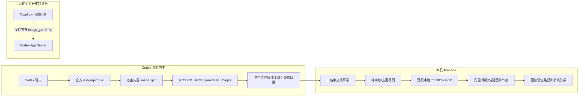

# Toonflow × Codex 官方 ImageGen 安全交接审计

日期：2026-11-17  
范围：只读源码/文档审计。未修改 Bridge 或 MCP，未读取认证凭证，未运行模型/生图/视频任务，也未消耗额度。

## 结论先行

- **A：Codex 桌面端使用官方 `image_gen` 生成后交给 Toonflow：可做手动或桌面内半自动交接。**官方 imagegen Skill 的默认内置工具模式不要求 `OPENAI_API_KEY`，生成产物默认放在 `$CODEX_HOME/generated_images/...`。Skill 说明宿主可以在生成后把产物复制到用户指定的项目位置。桌面端的本机会话/工具有文件操作能力时，可在同一 Codex 桌面会话中把选定图片复制到一个约定的 Toonflow 导入目录；随后再由安全导入流程创建节点。该流程不是 app-server 远程调用 image_gen。
- **B：Toonflow 前端直接发图片任务，由当前 Codex App Server 官方生图：目前不支持/没有公开证据。**Codex app-server 能管理线程、turn、事件、中断、审批并使用已配置工具与 MCP；但 OpenAI 的 Sign in with ChatGPT 预览限制明确列出 Image Generation 为不支持工具，CLI 版 Skill fallback 需 API Key，不适合本目标。因此不能将桌面宿主 `image_gen` 当成 app-server RPC 暴露。
- **C：本地任务队列半自动交接：可行，但要由 Codex 桌面先完成生成并复制文件。**队列只能监测本地指定交接目录中的新文件，不能因此调用 ImageGen。由本机服务检测、去重、预览/待审核，再通过受限 Toonflow MCP 创建图片节点并回读。无需 API Key、无需第二套生图服务，但“生成”仍由用户在 Codex 桌面里发起。

推荐先实现**方案 1**，验证文件交接和 Toonflow 节点关联；确认用户体验后再采用**方案 2**。方案 3 只有在 OpenAI 提供 app-server 可用的宿主 ImageGen RPC/事件或正式支持的插件扩展机制后才成立。

## 1. 官方 ImageGen、Skill 与入口边界

本机官方 Skill：`C:\Users\yth\.codex\skills\.system\imagegen\SKILL.md`，完整文件约 19,476 字符。已读取完整 Skill（本报告只摘取与架构有关的规则）：

| 入口 | Skill/官方证据 | 结论 |
|---|---|---|
| Codex 桌面宿主内置工具 | Skill 默认模式为 built-in `image_gen`；不要求 `OPENAI_API_KEY`。当前 Codex 会话工具清单中可见 `image_gen`。本轮没有调用。 | 可由当前桌面宿主进行生成/编辑；额度与当下账户策略有关，未查看余额。 |
| Codex CLI Skill fallback | Skill 的 `scripts/image_gen.py` CLI 明确需要 `OPENAI_API_KEY`；CLI 有 `generate`、`edit`、`generate-batch`。 | 不符合本项目禁止 API Key 的限制。 |
| Codex App Server + ChatGPT 登录 | 官方 Sign in with ChatGPT 预览限制列出 Image generation 不支持；App Server 的公开说明支持 thread/turn、事件、MCP、沙箱与审批交互。 | 本机 Bridge 不能通过公开 app-server RPC 调用宿主 `image_gen`。 |

Skill 还规定：

- 内置工具生成结果默认保存至 `$CODEX_HOME/generated_images/...`；需要项目使用时，再由宿主把最终文件复制/移动到项目目录。
- 不应依赖内置工具接受目标路径参数。
- 多张不同素材按“每个素材/变体一次内置调用”完成；CLI `generate-batch` 属于 API Key fallback，不等于内置工具的批量任务 API。
- 编辑本地参考图片时，先用内置 `view_image` 让图片进入当前会话上下文；不能承诺对任意文件路径直接编辑。
- 内置工具产物可显示在对话中；本地实际文件路径的管理由 Codex 宿主及 Skill 的复制步骤完成。

官方 API Image Generation 文档描述了 Responses API 的 `image_generation` 工具、`image_generation_call` 返回内容、图片输入、PNG/WebP 输出配置和多轮编辑。但是该 API 文档不是“ChatGPT 登录计划在 app-server 里可调用此工具”的证据；同时标准 API 路径不满足用户禁止 API Key/购买 API 的条件。[Image Generation API 文档](https://developers.openai.com/api/docs/guides/tools-image-generation)

官方 app-server/ChatGPT 登录文档明确说 `model/list` 可能是 bundled/cached catalog；对该 ChatGPT 登录通道，Image generation 属于 unsupported tools。[Codex app-server 说明](https://developers.openai.com/siwc/token-sharing-open-source/codex-app-server) [预览限制](https://developers.openai.com/siwc/token-sharing-open-source/preview-limitations)

官方产品用量说明区分 Codex 用量与 ChatGPT Images 的独立额度/重置期。不能由“Codex 登录成功”推断图片和文字共享同一个额度池，也不能推断外部 app-server 可使用桌面宿主 ImageGen。[Codex 套餐用量说明](https://help.openai.com/en/articles/11369540-using-codex-with-your-chatgpt-plan)

## 2. 桌面宿主、CLI 与 App Server 的区别

### App Server 的外部工具能力

OpenAI 公开说明允许 app-server 客户端创建/恢复线程、发送 turn、接收事件、处理中断和审批，也可配置 Codex 使用 MCP 工具。Agent 可调用应用显式提供的本地 MCP/自定义函数，工具结果进入 agent loop。它并不意味着客户端可任意调用宿主产品中不可见的工具；目前 ChatGPT 登录预览限制特别把 Image generation 标为不支持。不要自行添加私有 endpoint 或把 OAuth token 转交给 Toonflow。

官方也有 Computer Use / MCP 等独立工具产品，但它们有各自 API/Agents API 支持条件。没有证据表明“Codex ChatGPT 登录 App Server 可以通过 Computer Use 操作宿主自己的 image_gen 界面”是官方方案；用屏幕自动化点击 Codex 桌面也不是本轮可确认的正式 API 契约。

## 3. Toonflow 图片导入审计

本地项目源码版本：`6086cdffceb704a632eca143dd16cd461a78cdac`。

| 能力 | 源码证据 | 判定 |
|---|---|---|
| PNG/JPG 接收 | 图片节点上传 `<input accept="image/*">`；MIME 根据文件推断；节点上传限制 100 MB。服务端 URL 图片导入支持 PNG/JPEG/WebP/GIF/AVIF/BMP，最大 20 MB。 | 支持 PNG/JPEG。 |
| 指定本地目录 | 浏览器文件选择器可选文件；图片节点 `setImage` 接收工作区相对路径，验证文件存在、非空、最大 100 MB。 | 可从 Toonflow 工作区目录导入；网页不能任意读取宿主路径。桌面宿主可先复制入工作区/授权目录，再由 MCP 使用相对路径。 |
| 创建图片节点 | MCP 包含 `addNode`，其 type 必须来自 `getCanvas(include: ["nodeTypes"])` 提供的当前可用节点类型；新增后用返回的实际 ID 获取节点工具。 | 可通过已有 MCP 创建，不应直接改画布 JSON。 |
| 写入节点图片路径 | 图片节点暴露 `setImage({path, mimeType})`，读取工作区文件后把输出设为 `IMAGE`。 | 支持。 |
| 人物、场景、分镜关联 | 节点可在画布上连接；`setImage` 设置的是节点的图片输出，没有源码证据显示它自动识别 Toonflow 域对象或自动建立角色/场景/镜头外键。 | 需用画布连接、节点标签/说明或已有资产约定建立关系；不能称为自动语义绑定。 |
| 回读验证 | MCP `getCanvasNodes` 可按 ID 读取 `data`、`outputs` 等字段，`findCanvasNodes` 可定位节点；Skill 要求操作后回读。 | 可读取节点配置和文件相对路径。实际图像像素显示还需界面/图片预览验证。 |
| 防止重复 | `importImage` URL 路由用 URL SHA-256 哈希缓存，但本地图片节点上传路径和 `setImage` 不提供内容哈希去重承诺。 | 交接服务应自行维护内容 SHA-256 manifest，按“同项目 + 文件哈希 + 资产角色”判重，不覆盖既有节点。 |

源码：[`imageNode` 的 `setImage` 与上传](../packages/nodes/imageNode/src/index.vue)、[`imageGenerationNode` 的上传与输出](../packages/nodes/imageGenerationNode/src/index.vue)、[`importImage` 公网 URL 路由](../apps/server/src/routes/workspaces/files/importImage.ts)。MCP Skill 规定须先查 node types，使用 `addCanvas`/`addNode`/`connectNodes`，不可直接写带 `toonflowCanvas` 标记的 JSON，并应新增后按 ID 回读。[Toonflow MCP Skill](../packages/mcp/skills/toonflow/SKILL.md)

### MCP 文件导入接口边界

`setImage` 是节点工具，要求工作区相对路径。浏览器不能传一个 `C:\...` 路径让服务器任意打开文件。可选导入方式：

1. 用户通过 Toonflow 文件选择器上传图片；或
2. Codex 桌面宿主将选定产物复制到**用户预先授权**的 Toonflow 工作区/交接目录；再由 MCP 对 Toonflow 工作区相对路径调用 `setImage`；或
3. 受控本地导入服务从严格固定的交接目录读取文件，验证 MIME/大小/哈希，再用 Toonflow 已有本地文件写入能力写入工作区，然后调用现有 MCP 添加节点并 `setImage`。

Toonflow MCP 的工具清单有 `addCanvas`、`addNode`、`findCanvasNodes`、`getCanvasNodes` 等。是否能直接通过某个 MCP 工具上传任意二进制内容，需以当前实际 tool schema 为准；本次没有运行写操作，设计优先使用既有节点上传或授权工作区文件路径。

## 4. 安全交接架构与控制

推荐把生成与导入明确分开：

1. 用户在 Codex 桌面输入创作要求；Skill 使用桌面宿主内置 `image_gen` 生成或编辑。
2. Codex 宿主返回选定产物路径；用户明确选择“交给 Toonflow”，宿主复制到例如 `C:\Users\yth\Desktop\Toonflow\workspace\_codex_import\<project>\` 的授权目录。该目录应是实际 Toonflow 工作区下的子目录；不能假设仓库本身就是工作区。
3. 独立本地队列只监听这个固定路径（不要监听 Downloads、整个用户目录或任意网页传入路径）。队列记录文件哈希、MIME、大小、来源提示、目标画布/资产类别、导入状态；不解析或访问 Codex 凭证。
4. 新文件默认待审核，不自动覆盖；重复哈希提示已导入记录或创建新版本副本。验证只接受 PNG/JPEG，限制体积，拒绝扩展名/MIME/文件签名不一致、路径穿越、符号链接越界文件。
5. 导入时由本机 MCP 查目标画布及可用 `imageNode` 类型，新增节点，调用 `setImage` 指定 workspace-relative path 和 MIME，标签写明角色/场景/镜头 ID、生成批次和状态。
6. 用 `getCanvasNodes` 回读节点 ID、类型、路径和连接；校验目标文件存在且 SHA-256 与导入清单一致。失败标记为失败并保留源文件/日志；重试按 idempotency key 避免重复节点。
7. 只绑定到本地 Toonflow 服务允许的目录及 `127.0.0.1`。导入服务不提供任意文件读取、shell、URL fetch 或外部通用写入 API；MCP 只启用必要画布/文件工具。

## 5. 三档实施方案

### 方案 1：最小改造（推荐先做）

**桌面生成，人工/半手动导入。**Codex 桌面使用 Skill 内置 `image_gen`；让桌面宿主将选定成品复制到 Toonflow 的授权工作区目录；在 Toonflow 画布新增现有图片节点，上传图片或调用 `setImage`；连接到人物/场景/分镜相关节点，并回读路径。

- 官方支持程度：桌面宿主内置工具 + 本机 Skill 的默认路径；本地文件复制属于宿主文件操作，不是 App Server ImageGen RPC。
- 难度：低。
- 限制：仍需用户手动选择生成产物和触发导入；无需 API Key；图片调用仍可能受 ChatGPT Images 自身用量限制。

### 方案 2：半自动工作流

在方案 1 基础上增加固定目录的 watcher/导入队列。Codex 桌面生成完并明确复制到交接目录后，服务显示待导入项，用户确认目标项目、资产类型及画布；服务使用现有 MCP 建图像节点、设置图片路径、回读校验。

- 官方支持程度：**生成部分由桌面官方宿主完成；目录 watcher 和 Toonflow 导入是自建本地集成**，不调用非公开 ImageGen 接口。
- 难度：中等；需验证 Docker 工作区和 Windows 宿主目录映射、文件 ACL、MCP 工具范围与连接身份。
- 限制：不能由 Toonflow 聊天直接启动宿主 ImageGen；必须由桌面用户把结果放入授权目录。需要稳定的项目/角色/场景/分镜 ID manifest。

### 方案 3：完整集成

Toonflow 提交图片任务 → app-server 调桌面宿主 `image_gen` → 文件自动返回 → MCP 自动创建节点。

- 官方支持程度：**当前无证据/当前 ChatGPT 登录 App Server 文档明确不支持 Image Generation 工具。**因此暂不可实施为官方受支持方案。
- 难度：不是单纯开发量问题，而是缺少宿主能力公开接口。未经授权地桥接 UI 私有协议、OAuth token 或内部 endpoint 不接受。
- 后续成立条件：OpenAI 官方公开支持 app-server 暴露/委托宿主 `image_gen` 的 RPC、事件或稳定 SDK；明确图片用量、结果流/本地文件导出契约；再实现受控本地回传。

## 6. 实施建议

1. 保留 Toonflow 现有画布、图片节点、工作区文件和 MCP；H3 Provider 保持原样，用于之后的图生视频。
2. 先采用方案 1 做最小闭环：桌面生成 → 宿主复制到授权工作区 → Toonflow 图片节点上传/`setImage` → 画布连接 → `getCanvasNodes` 回读。
3. 确认手动流程稳定后，再做方案 2 的白名单目录导入服务。**文件交接服务只负责文件校验与 Toonflow 导入，不启动 Codex、不触碰 Codex auth 文件、不伪造 ImageGen 调用。**
4. Bridge 内文本聊天仍可写剧本/资产提示词和目标绑定清单；当前 Bridge 不能让 app-server 自己调用 ImageGen。可把图片生成请求输出成可复制的创作卡片，用户在桌面继续生成。
5. 只有获得官方 app-server ImageGen 支持后再考虑方案 3。当前不建议安装 Canvas-Codex 或第三方网页登录自动化来填补缺口。

## 7. 风险与验收点

| 风险 | 控制/验收 |
|---|---|
| Skill 默认输出位置与 Toonflow 文件目录不一致 | 桌面宿主显式复制到固定授权目录；导入后节点路径指向 Toonflow 工作区文件，而非 `$CODEX_HOME` 临时引用。 |
| 网页任意读取宿主文件 | 前端不接收本机绝对路径、不开放任意文件服务；只允许固定目录 watcher 或显式上传。 |
| 图片 MIME/路径伪造 | 内容签名、扩展名、MIME、大小、realpath 范围同时校验。 |
| 重复导入或覆盖正式资产 | SHA-256 去重；默认新建带版本标记的文件和待审核节点，不覆盖。 |
| MCP 写入成功但节点/文件关联错误 | 保存真实节点 ID，调用 `getCanvasNodes` 回读 `data/outputs`，并用界面预览确认。 |
| Codex 额度与图片限额误解 | UI 分别说明 Codex 使用额度和 ChatGPT 图片额度；不显示无限/免费保证。 |
| App Server 被错误扩展为私有生图客户端 | 不加私有 endpoint；不提取/复制 OAuth token；不把 API Key 模式冒充会员模式。 |

## 8. 证据分级与未验证项

- **本机源码/文件确认：**imagegen Skill 全文、其内置与 CLI fallback 规则；Toonflow `imageNode`、`setImage`、图片上传、MCP 画布操作实现；本机 Codex Bridge 为文本对话路径（既有源码）。
- **官方文档确认：**App Server 是 thread/turn/event/MCP 集成面；ChatGPT 登录预览通道不支持 Image generation；OpenAI Images API 文档提供独立 API 工具调用但需按 API 路径使用。
- **本轮运行验证：**没有运行生图或写入节点；没有测试实际产物复制或 Docker 工作区挂载。只读核对工具和源文件。
- **尚未确认：**桌面当前内置工具对所有用户/计划的持续可用性、账户实际图片额度；桌面宿主复制文件时的具体 UI 路径（因未执行生成）；Docker 生产工作区的真实路径映射；现有 MCP 是否有二进制直传工具（本方案不依赖该能力，优先走工作区路径 + `setImage`）。

## 参考链接

- [官方 imagegen Skill（本机）](C:/Users/yth/.codex/skills/.system/imagegen/SKILL.md)
- [Codex app-server：Sign in with ChatGPT](https://developers.openai.com/siwc/token-sharing-open-source/codex-app-server)
- [Sign in with ChatGPT 预览限制](https://developers.openai.com/siwc/token-sharing-open-source/preview-limitations)
- [Codex 套餐用量与 ChatGPT 图片限额](https://help.openai.com/en/articles/11369540-using-codex-with-your-chatgpt-plan)
- [Codex app-server 作为平台集成](https://developers.openai.com/blog/codex-as-a-platform)
- [OpenAI Image Generation API](https://developers.openai.com/api/docs/guides/tools-image-generation)（技术参考；不建议用于本项目的订阅额度闭环）
