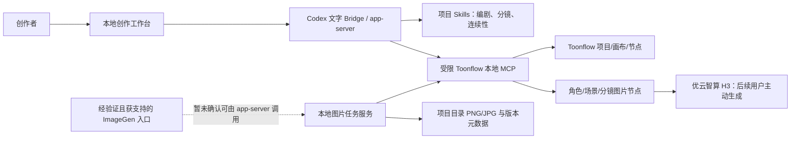

# AI 可视化创作工作台专项研究

日期：2026-11-17  
范围：只读研究；未修改 Toonflow、未安装依赖、未调用 API/模型、未生成媒体、未使用 H3。

## 结论摘要

**推荐：保留 Toonflow 做动画项目与分镜资产管理，另建一个受控的本地 ImageGen 生产面板，先验证官方支持的图像能力接口，再以文件导入/MCP 回写 Toonflow。第二备选：使用 Canvas-Codex 做轻量画布原型，但不要把其“ChatGPT 网页会员生图”浏览器自动化后端作为正式生产方案。**

关键限制：当前 Codex 桌面会话可见内置 `image_gen` 工具；本机安装了官方 imagegen Skill。但 OpenAI 的 Sign in with ChatGPT 预览文档明确列出，该 Responses 通道不支持 Image Generation 工具。没有证据表明本机 `codex app-server` 提供图片生成 RPC。桌面工具存在不等于 CLI/app-server 可调用。Skill 内置模式默认把生成文件存到 `$CODEX_HOME/generated_images/...`，不支持保证直接写任意项目路径；需由宿主后续复制。Skill 的 batch 语义是多次逐图调用，不是稳定的后台批量任务 API。

所以“现有会员登录 + 本地可视化画布 + 自动调用原生 ImageGen + 无 API 费用”的完整闭环，**当前官方公开支持接口未确认**。Canvas-Codex 确实尝试实现该闭环，但其 web 路径通过 Chrome 自动化登录态来操作 ChatGPT 网页；README 自己也标注这条路径更脆弱。它不应被误认为 OpenAI 官方授权的桌面/CLI 集成。

## 1. Codex 原生 ImageGen 审计

### 本机可见能力

- 官方 imagegen Skill 存在于 `C:\Users\yth\.codex\skills\.system\imagegen\SKILL.md`，约 19,476 字符。完整文件已检查；规定默认内置工具模式、不需要 `OPENAI_API_KEY`，CLI fallback 需 API Key；支持生成/编辑；多张不同图要逐项调用内置工具。内置工具输出默认保存在 `$CODEX_HOME/generated_images/...`，需要项目资产时再移动/复制。
- 当前 Codex 桌面本轮可见 `image_gen` 工具；这是此 Codex 会话的宿主工具。未调用它。
- Codex CLI/app-server 本轮未找到图片生成 RPC 的运行时证据。官方 app-server/ChatGPT 登录说明的预览限制明确列出不支持 Image generation 工具。因此不能承诺由 Toonflow Bridge 里的 app-server 会话发起生成。
- 对话中可用的工具结果可以返回图像内容，但本次工具规范并不承诺一个可由 Toonflow 直接访问的稳定本地路径。Skill 的规定是生成后由本地宿主把文件复制到项目工作区。
- Skill 的 CLI fallback `scripts/image_gen.py` 属于 OpenAI API 路径，需要 `OPENAI_API_KEY`，不符合“不购买 API”的目标；本报告不建议使用。

### 订阅额度与合规边界

- Codex 文本使用 ChatGPT 登录计划额度，可能受计划限制、可用 credits 或相关计费策略影响；不能保证永远零追加成本。
- ChatGPT Images 的额度限制和 Codex 使用额度是分开的。官方 Help Center 表示 ChatGPT 图片生成有单独 usage limits/reset periods；Codex 额度按模型、任务等因素计量。不得把“Codex 会员聊天额度”推断成“Bridge 可任意调用 ChatGPT 图片额度”。
- Codex 的 OAuth 登录态不是 API Key。不得提取 token 再伪装为 API Key，也不得用未公开内部接口绕过公开能力限制。
- Codex CLI `codex exec` 可执行 CLI 任务，但没有本机证据证明它公开支持 ImageGen 工具调用；官方 CLI/app-server 文档不应与 Codex 桌面当前会话可见的宿主工具混淆。

官方依据：

- [OpenAI Codex app-server / Sign in with ChatGPT](https://developers.openai.com/siwc/token-sharing-open-source/codex-app-server)
- [Sign in with ChatGPT 预览限制](https://developers.openai.com/siwc/token-sharing-open-source/preview-limitations)
- [Codex 套餐用量说明](https://help.openai.com/en/articles/11369540-using-codex-with-your-chatgpt-plan)
- [Codex 用量限制说明](https://help.openai.com/en/articles/20001625-understanding-chatgpt-and-codex-usage-limits)

## 2. Canvas-Codex 源码与风险

项目：[jiangzizhao/canvas-codex](https://github.com/jiangzizhao/canvas-codex)

检查到 GitHub 页面报告 **4 stars、1 fork、3 commits、MIT**，项目体量是几支脚本加安装说明，不是成熟动画生产系统。仓库 README 描述：Excalidraw/MCP 画布，Codex CLI 或 Claude Code 作为助手，脚本把生成图片放到画布；支持参考图再生成的编辑循环。

### 两种“生图后端”必须分开看

- `web`：README 指向 `chatgpt-imagegen` + `chrome-use`。这会驱动用户已登录的 Chrome/ChatGPT 网页。它不是 app-server RPC，也不是 OpenAI 公布的 ChatGPT 会员生图 SDK。依赖网页 UI、浏览器扩展和网页状态，UI 改版/安全验证变化可能失效；扩展需要浏览器调试能力，扩大 Chrome 会话的访问面。项目 README 自承认此后端更脆弱，并提示调试横幅。官方服务条款与具体自动化行为是否允许不能由项目自身声明代替；不能把它当受支持的官方集成。
- `codex`：README 表示经 `chatgpt-imagegen` 使用 Codex 用量。当前所见仓库只有 3 commits，尚未对 `chatgpt-imagegen` 上游实现做完整依赖源码审计，不能验证它调用的是官方公开能力、可用额度、图片编辑和 Windows 行为。
- `OpenAI API`：按张 API 费用，需要密钥，与本项目“不购买 API”不符。

安装说明以 Bash/macOS 风格为主，依赖 Node、Python、Google Chrome、Excalidraw MCP、chatgpt-imagegen 和 chrome-use；Windows 11 原生支持没有在其 README 中证实。画布元素是否持久化也需注意：README 称其画布重启会清空，须导出留存。没有角色/场景/分镜数据库模型；MCP 依赖另一个 Excalidraw 服务。

判断：可作为**隔离实验原型**来研究画布交互；不推荐把其会员网页登录自动化直接放进生产创作流程。不能因 README 写“会员可用”就判定合规或长期稳定。

## 3. 其他开源项目

### ComfyArt

[jtydhr88/ComfyArt](https://github.com/jtydhr88/ComfyArt) 当前 GitHub 页面显示 566 stars、98 forks、73 commits、MIT。它是 ComfyUI 插件式无限画布，含项目、聊天 Agent、素材管理、角色/产品/参考板、编辑和 MCP 操作；项目和 agent 聊天存储于 SQLite。源码页面显示 `src/`、`api/`、`bot/`、`web/`、`tests/` 等目录，并包含预构建 `dist/`。

官方 README 说明默认本地 ComfyUI 工作流、本地模型和本机硬件；也能选 Comfy Cloud，但需要 Comfy Cloud API Key/付费计划。**未发现 ChatGPT/Codex 登录或 ChatGPT 原生图片生成接入。**适合“本地模型、可接受配置 ComfyUI/GPU”的方向，不满足“ChatGPT 会员生图零 API”的关键条件。

### Retake Whiteboard

[retake-tools/whiteboard](https://github.com/retake-tools/whiteboard) 的项目页描述本地无限画布、Codex/MCP 工作流、图像生成/编辑 Operation、项目与画布范围权限。它的生成能力要求 Codex 有一个实际可用的图像能力；仅有 ChatGPT 登录并不自动提供 app-server ImageGen。属于较值得后续核查的“画布 + Agent”候选，但当前未本地安装、未确认其在 Windows 的运行成熟度、发行物、维护指标和调用的图像 Provider。

### Scumble（补充候选）

[DenRakEiw/scumble](https://github.com/DenRakEiw/scumble) 页面描述为 Windows 桌面图像编辑器、ComfyUI/云模型编辑、MCP 命令操作。它擅长图像编辑和图层，不是动画项目/分镜总画布；云服务依赖各自 API/账户，不代表可使用 ChatGPT 会员额度。

## 4. Toonflow 现有能力

本地源码版本为 `6086cdffceb704a632eca143dd16cd461a78cdac`；仓库工作区已有未提交部署及 Bridge 改动，本研究没有修改这些文件。

- Toonflow 具备无限画布式节点工作区、图片/图片生成节点、媒体 Provider、工作区文件、节点输出、画布历史、MCP 工具和项目目录结构，适合动画资产与分镜组织。
- 图片节点可上传本机图片或把工作区图片路径设置成 IMAGE 输出；图像生成节点可以从 Provider 生成并把结果保存到工作区。图片结果可通过节点输出引用到下游视频节点。
- H3 Provider 保持作为后续视频环节；本轮未调用。用户使用优云智算 H3，因此不需要换视频平台。
- 当前自定义 `codexBridge/server.mjs` 仍是只处理文字的 app-server 聊天 Bridge，代码中禁用了 `mcp_servers.toonflow`；其线程使用只读 sandbox。因此它当前不能通过 Toonflow MCP 改画布，也不能从 app-server 发起 ImageGen。
- Toonflow 原生媒体 Provider（含已有 Compshare/优云智算）通常按各自 Provider 配置调用，不能视作 ChatGPT 会员额度入口。

建议把图片生产独立成一个受控模块或任务服务，但先不连接未公开接口：服务职责限定在“收集生成/编辑任务 → 调用已被证明可用的受支持能力 → 保存图片到项目目录 → 由 Toonflow 本机 MCP 创建/更新图片节点并回读”。若唯一可用办法是自动化 ChatGPT 网页，则需要单独审查使用规则和浏览器权限，不应作为默认生产架构。

## 5. 方案对比

状态标记：**源码确认** = 仓库代码/项目文件可见；**官方文档确认** = OpenAI/项目官方文档直接说明；**运行验证** = 本轮或已有本地运行检查；**未验证** = 未运行或无官方证据。

| 维度 | A：Codex ImageGen + 可视化画布 | B：Canvas-Codex | C：ComfyArt | D：继续改造 Toonflow | E：Retake Whiteboard |
|---|---|---|---|---|---|
| ChatGPT/Codex 登录 | 桌面 Codex 已登录（用户环境）；App Server 文字登录官方支持；生图联动未确认 | README 声称 web/Codex 后端；实际链路需审计 | 不支持 ChatGPT 登录，ComfyUI 本地或 Comfy Cloud | 文字 Bridge 已接 ChatGPT 登录；原生 ImageGen 未支持 | Codex/MCP 集成描述可见；实际模型/图像能力取决于工具配置 |
| 会员图片额度 | 桌面宿主工具可见；通过 CLI/app-server 接入未支持/未确认 | web 后端声称走 ChatGPT 网页额度，浏览器自动化；codex 后端未审计上游 | 不使用 ChatGPT 额度 | 不能直接借用桌面宿主 ImageGen；需受支持连接 | 未确认，可接能实际提供图像工具的 Codex/模型服务 |
| 图片编辑 | Skill 支持编辑；调用链不等于 Bridge 支持 | README 有参考图再生成；细节需核对上游 | 有大量编辑工具/工作流 | Toonflow 图片节点有编辑操作，生成由 Provider 决定 | 页面描述有 edit operation，源码/运行未核验 |
| 聊天体验 | Codex 原生聊天好；外部画布需接工具 | CLI 聊天 + 画布 | Agent 聊天 + 画布 | Toonflow 聊天 Bridge 已运行，但目前只文本 | 画布 Agent 聊天 |
| 无限画布 | 需选画布应用 | Excalidraw | tldraw | 当前已有 | 项目描述支持 |
| 角色/场景/分镜管理 | 需业务层建模 | 未见动画专用管理 | Assets/characters/reference board，动画分镜未确认 | 节点/工作流可管理，专门页面需改造 | 通用白板，无动画域模型证据 |
| MCP | Codex app-server 本身不等于能把宿主 ImageGen MCP 化 | 使用 Excalidraw MCP；Codex CLI 可接 | Agent 经 MCP 操作设计画布 | 有 Toonflow MCP；当前本机 Bridge 尚未启用 | 项目主打 MCP/Codex |
| Windows | Codex/Toonflow 已在 Windows；集成待开发 | Bash 安装脚本，原生 Windows 未确认 | 需安装/运行 ComfyUI Windows 环境 | 本地 Docker 已运行 | 未验证 |
| 本地文件/项目持久化 | Skill 文件需宿主复制 | README 称 Excalidraw 画布重启会清空，需导出 | SQLite 项目/聊天；本地工作流 | Toonflow 工作区文件、项目和画布 | 本地优先为项目描述，实际 schema 未验证 |
| OpenAI API 成本 | 桌面内置 Skill 模式称无需 API Key；额度与产品可用性受限，app-server 不支持 | web/Codex 自述无需 API，但浏览器/Codex 路径合规与维护未验证 | 本地 GPU 无 API；云选项付费 | 文字走订阅；图像 Provider 可能另计 | 取决于配置的生成服务 |
| 安全/成熟度 | 官方桌面功能安全边界清晰；外部落盘/画布集成需开发 | 4 stars/3 commits；自动化浏览器是主要风险 | 566 stars/73 commits/MIT；ComfyUI/GPU 门槛 | 已有动画产品与 H3 流程；需谨慎扩展 Bridge | 值得评估但本轮未审源码/运行 |

## 6. 推荐架构

目前图中虚线是阻塞点：没有官方支持的 Codex app-server ImageGen 工具接口证据。图片任务服务不应通过复制 OAuth token 或未公开 endpoint 来填补这一缺口。若 OpenAI 后续提供宿主工具/API 集成，服务可用插件式 Provider 接入，并把文件写入 Toonflow 本地工作区，再调用 MCP 建节点、回读校验。

## 7. 推荐实施路线

1. **保留 Toonflow 为主项目。**它已经提供动画项目、画布、图片节点、工作区文件、MCP 和 H3 Provider，不必重做动画业务管理。
2. **先完成受控的 Bridge → Toonflow MCP 接入。**只暴露经过审查的本地工具白名单；读写工具分开；写操作要求用户明确确认；每次创建或更新后通过 MCP 回读。禁止任意 shell 与其他目录访问。
3. **将 `v118workflow` 与 storyboard Skill 作为项目级只读上下文/Skills 加载。**保留引用文件的相对目录，不复制到前端。按故事大纲、分集剧本、场景表、分镜表、图像提示词、视频提示词分阶段写画布；草稿/正式版分节点存储，记录版本来源与状态。
4. **图片生成先做能力验证门槛，不先写适配器。**需要 OpenAI 提供可由本地应用合法调用且覆盖 ChatGPT 计划用量的公开接口，或确认 Codex 官方宿主工具可扩展/委托调用。没有此项时可选择本地模型，但那不是 ChatGPT 会员能力。
5. **通过后再加最小图片任务服务。**接受提示、目标角色/场景/镜头 ID、参考素材；调用受支持生成/编辑提供方；产物落盘到项目 `assets/...`；MCP 导入或设置图片节点；读回验证文件、MIME、节点 ID 和关联关系。保留任务日志、取消、失败状态和重试保护。
6. **最后才连接 H3。**用户确认生成范围和费用后，使用 Toonflow 现有 H3 Provider；参考图从画布 IMAGE 节点连线输入，不要绕过 Provider 或暴露公网。

## 8. 风险清单

| 风险 | 影响 | 控制方式 |
|---|---|---|
| 把 ChatGPT 登录 token 当作 API 凭证 | 凭证泄露、违反登录边界 | 不读取/复制 token；使用 Codex 官方公开集成面 |
| 将桌面 `image_gen` 当作 app-server RPC | 方案无法运行或误报完成 | 当前明确标为未支持；先以官方文档或公开 RPC 证实 |
| 浏览器自动化复用 ChatGPT 网页订阅 | 网页改版失效、会话暴露、规则不确定 | Canvas-Codex 的 web 后端仅隔离实验，不作生产依赖 |
| ChatGPT 图像额度与 Codex 额度混淆 | 误判零成本/额度可用 | UI 展示当前通道和用量提示；不给“免费无限”承诺 |
| MCP 可写能力过宽 | 误删/覆盖画布或其他项目 | 本地 Toonflow 工具白名单、路径限制、写入确认和回读 |
| 生图落到临时或工具私有目录 | Toonflow 无法长期引用文件 | 成功结果复制到项目工作区并校验，不依赖临时 URL |
| 无动画域模型的通用白板 | 角色/分镜关系靠人工命名 | Toonflow 节点元数据/约定作为唯一业务来源 |
| 模型及第三方项目快速变化 | 文档与代码过期 | 集成前固定 commit、查 license、做安全和升级审计 |

## 9. 明确推荐

**最适合：方案 D（继续改造 Toonflow）作为动画项目管理和 H3 前端，配合方案 A 的 Codex 文字创作与可视化工作流；但当前不要承诺将 Codex 桌面 ImageGen 直接接入 Bridge。**先接好 Skills + 受限 MCP，确保剧本、人物、场景和分镜能由聊天写入画布；图片入口等待官方支持路径，或单独选择本地 ComfyUI 图像模型并接受其非 ChatGPT 会员属性。

**第二备选：Canvas-Codex 仅作短期 UI/工作流原型。**它画布轻巧，能验证聊天—批注—再生成循环；但小型仓库、画布重启持久性、浏览器自动化路径及上游生图脚本都需要额外审计，不能作为会员额度稳定/合规保证。

ComfyArt 是“完全本地模型 + 视觉工作台”方向更成熟的候选，但要求 ComfyUI 和本地 GPU/模型，解决的是另一个目标；不满足严格的 ChatGPT 会员生图要求。

## 10. 未完成验证项

- 本轮没有安装/运行 Canvas-Codex、ComfyArt 或 Retake Whiteboard。
- Canvas-Codex 的间接依赖 `chatgpt-imagegen`、`chrome-use` 未在临时目录完整克隆审计；其 README 之外的实现细节、最新 commit 日期、Windows 行为、服务条款结论均未验证。
- 未验证 Codex CLI `exec` 图片生成能力；没有运行任何模型任务。
- Codex 桌面当前工具可见不代表本地 Toonflow Bridge 可以调用它。
- 本轮没有访问 Toonflow MCP 写接口，也没有改动任何配置或源文件。
